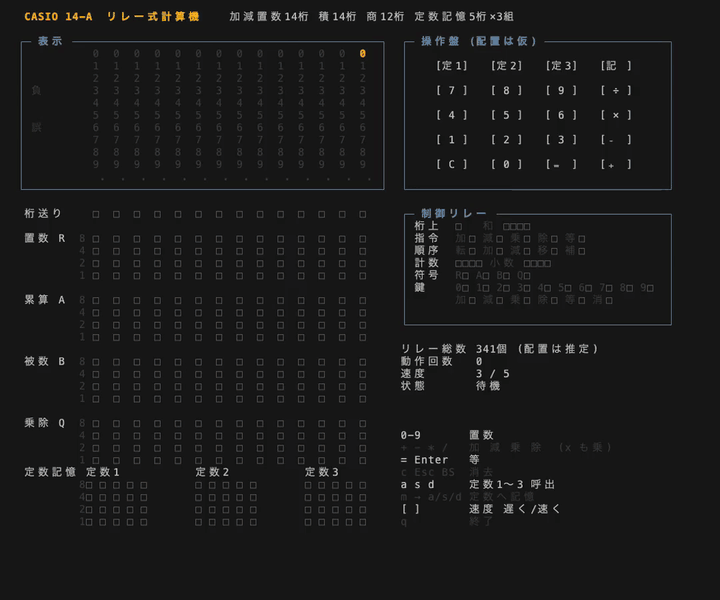
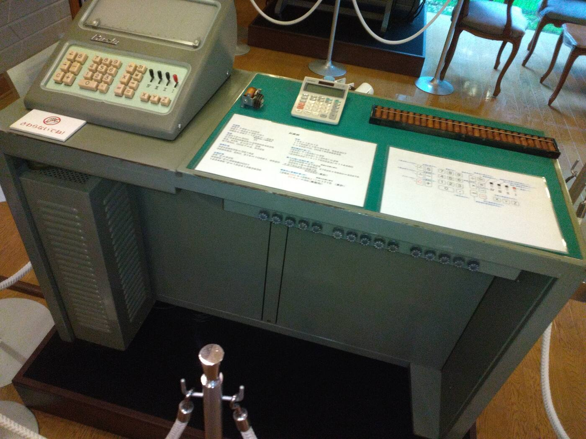
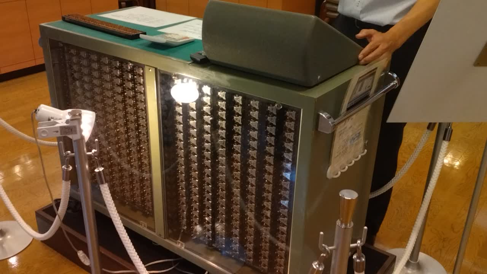
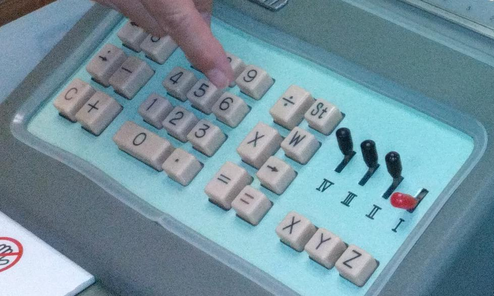

# CASIO 14-A リレー式計算機 ターミナル再現

1957年にカシオが発売したリレー式計算機 **14-A** の、リレーの動き・豆ランプ表示・操作をターミナル上で再現する Python スクリプトです。四則演算を1桁ずつの加減算として実際に進め、そのたびに 341 個のリレー(■=動作 / □=復旧)の状態を描き直します。



123×45 と 10÷3 を計算しているところです([MP4](docs/demo.mp4))。キー入力から答えが出るまでに、掛け算はリレー動作 170 ステップで約1秒、割り算は引き算と桁送りを繰り返すため 1,314 ステップで約6秒かかります(速度設定 3/5 の場合)。

## 経緯

2026年9月29日、東京・成城の[樫尾俊雄発明記念館](https://news.mynavi.jp/article/20150730-casio/)を見学し、14-A の動態展示を見ました。とくに、背面に見える 341 個のリレーがカチカチと連鎖しながら計算を終えていく動作は圧巻でした。

<p>

<a href="docs/14a_relays.mp4"></a>
</p>

左: 14-A の実機。そろばんと現代の電卓が並べてあり、大きさの違いが分かります。右: 341 個のリレーが動く様子([動画](docs/14a_relays.mp4))。

同時に、その原理についてあまりにも不勉強な自分が恥ずかしくなりました。レジスタ、記憶、表示などを担っているはずのリレーのうち、どれが何なのかまでは分からなかったからです。そこで、少し勉強してみようと考え、その教材としてこのエミュレータを作りました。

## 狙い

このエミュレータで、次の3つを学ぶことを目指しています。

1. **論理から四則演算へ**
   リレーで OR・NOT・XOR を処理でき、これが電卓を組み立てる最小の要素になります。これらを組み合わせて、特に乗算と除算を実装する理論を学びます。
2. **341個の割り当てを類推する**
   341 個のリレーは、レジスタ・記憶・表示などの役割を分担しているはずです。それぞれに何個ずつ割り当てられているかを類推します。
3. **除算はなぜ数秒かかるのか**
   リレー計算機で除算に数秒かかる理由を、ここまでの学習を踏まえて説明します。

## 実機の仕様

記念館の解説パネルなどによる仕様です。

| 項目 | 内容 |
|---|---|
| 発売 | 1957年 |
| 主な機能 | 四則演算 14桁、定数記憶 5桁×3組、自動累計計算 |
| 桁数 | 加減置数 14桁、積 14桁、商 12桁 |
| 主要素子 | リレー 341個 |
| 寸法・重量 | 幅 1080mm × 高さ 780mm × 奥行き 445mm、140kg |
| 価格 | 485,000円 |

日本で初めてテンキーを採用した計算機でもあります。表示窓は14桁のもの1つだけで、入力した数字は消えて答えが表示されます。国立科学博物館や米国のスミソニアン博物館にも収蔵されています。

## 実行

Python 3 の標準ライブラリだけで動きます。

```sh
python3 casio14a.py          # 起動
python3 casio14a.py --test   # 演算のセルフテスト
```

ターミナルは **幅98 × 高さ42 以上** が必要です。iTerm2 で表示が崩れる場合は、Profiles → Text の「Treat ambiguous-width characters as double width」をオフにしてください(■□×÷ の幅が変わるため)。

## 操作

| キー | 動作 |
|---|---|
| `0`〜`9` | 置数 |
| `+` `-` `*` `/` (`x` も乗算) | 加 減 乗 除 |
| `=` / Enter | 等 |
| `c` / Esc / BS | 消去 |
| `a` `s` `d` | 定数1〜3の呼び出し |
| `m` のあと `a` `s` `d` | 表示中の値を定数1〜3へ記憶(5桁以内の正の整数) |
| `[` `]` | アニメーション速度 遅く / 速く(5段階) |
| `q` | 終了 |

計算中に打ったキーは溜めておき、計算が終わってから順に処理します。

## 画面の構成

- **表示部**: 14桁それぞれに 0〜9 を縦に並べ、該当する数字だけを豆ランプ色で点灯します。下に小数点のランプ、左に「負」と「誤」のランプがあります。
- **リレー架**: 数を保持するレジスタ4本と、定数記憶・制御リレーを ■□ で表示します。
- **操作盤**: 押したキーが光ります。
- **制御リレー**: 桁上げ、演算指令、動作順序などの状態を表示します。リレーが切り替わった累計回数も数えています。

## リレーの割り当て(推定)

実機の回路資料は確認できなかったため、総数が実機と同じ 341 個になるよう、次のように推定で割り当てています。1桁は BCD(8-4-2-1)のリレー4個で保持します。

| 区分 | 内容 | 個数 |
|---|---|---:|
| 置数 R | 入力中の数(14桁×4) | 56 |
| 累算 A | 計算結果・被除数の余り(14桁×4) | 56 |
| 被数 B | 加数・被乗数・除数(14桁×4) | 56 |
| 乗除 Q | 乗数の残り回数・商(14桁×4) | 56 |
| 定数記憶 | 5桁×4×3組 | 60 |
| 桁送り | 処理中の桁を示すリング(14桁) | 14 |
| 加算器 | 桁上げ1、和4 | 5 |
| 演算指令 | 加・減・乗・除・等 | 5 |
| 動作順序 | 転送・加算・減算・桁移し・補数 | 5 |
| 計数 | 加算・減算の繰り返し回数 | 4 |
| 小数位 | 累算 A の小数点以下の桁数 | 4 |
| 符号 | R・A・B・Q の正負 | 4 |
| 鍵 | 0〜9、加減乗除等、消去 | 16 |
| **合計** | | **341** |

## 演算のしくみ

- **加減算**: 最下位の桁から1桁ずつ足し(引き)、桁上げ(借り)を次の桁へ渡します。引いた結果が負になったら、補数を取って符号を反転します。
- **乗算**: 乗数の各桁の値の回数だけ、被乗数を1桁ずつずらしながら足し込みます(計数リレーが残り回数を数え下げます)。
- **除算**: 累算 A と乗除 Q をひと続きのレジスタとして左へ1桁送り、除数を引けるだけ引きます。引きすぎたら足し戻し(引き戻し法)、引けた回数を商の1桁にします。商が12桁に達するまで小数部を求めます。

除算が遅いのは、商の1桁ごとに「桁送り → 引き算を最大10回 → 最後の引きすぎを戻す」を繰り返し、しかも1回の引き算が14桁ぶんのリレー動作になるためです。

## 実機と異なる点

- **リレーの配置と符号化**は推定です(上の表を参照)。
- **操作盤のキー配置は仮**です。記念館で撮った写真では、実機の操作盤は次のようになっていました。

  

  - 左: C・＋・－ などの加減算用キー
  - 中央: テンキー(0 は横長)と小数点キー
  - 右: ÷・×・＝ のほか、St・W・→ などのキー
  - 右下: 定数記憶用の X・Y・Z キーと、I〜IV のレバー

  いくつかのキー(St・W・→ など)とレバーの機能は、まだ分かっていません。
- **小数点の入力**には対応していません(割り算の結果だけが小数になります)。
- **自動累計計算**は未実装です。

## デモ動画の作り直し

[VHS](https://github.com/charmbracelet/vhs) で録画しています。

```sh
vhs docs/demo.tape
```

## 参考

- [「14-A」開発に成功 | CASIO](https://www.casio.co.jp/company/brothers/story03/)
- [「リレー」とは？カシオ初期の計算機を支えたキーデバイス | CASIO](https://www.casio.co.jp/topics/article/2025/K-094/)
- [カシオ14-A - コンピュータ博物館 | 情報処理学会](https://museum.ipsj.or.jp/computer/dawn/0069.html)
- [Casio 14 series - Wikipedia](https://en.wikipedia.org/wiki/Casio_14_series)
- [樫尾俊雄発明記念館 | マイナビニュース](https://news.mynavi.jp/article/20150730-casio/)
